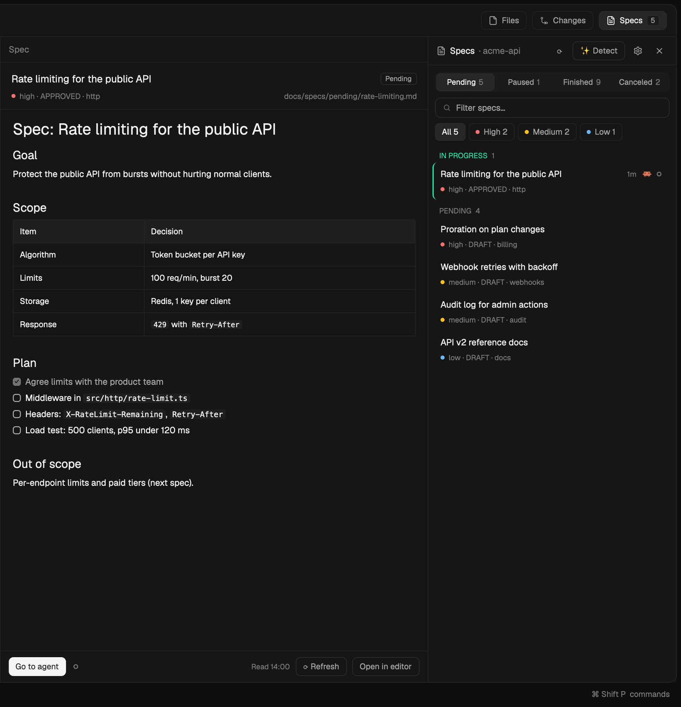

# SDD-Focused

Spec-driven development in [Herdr](https://herdr.dev): a Specs panel that follows the active space's project, lists its specs by status, renders any spec in a pane beside your terminal, and starts a coding agent on it in one click.



- **Specs by status:** Pending, Paused, Finished and Canceled, read from your repo's spec folders (`docs/specs/pending`, `docs/specs/finished`, … in English or Spanish).
- **Filter, pin, mark:** search by text, filter by priority, pin critical specs to the top, mark the ones in progress.
- **Read specs rendered:** click one and it opens in a pane, Markdown rendered.
- **▶ Work on it:** opens a tab with your agent working on that spec. The list then shows that agent's live state (working, needs you, done).
- **✨ Detect:** for unusual layouts, a cheap agent (Claude Code with Haiku by default) finds your spec folders and writes the config for you.
- **⚙ Agents:** choose the agent, model and autonomous mode for each job, from the agents installed on your machine.

## Install

```sh
git clone https://github.com/josedugu/sdd-focused && cd sdd-focused
cp -R mods/sdd-focused ~/.config/herdr-app/mods/
herdr-app check ~/.config/herdr-app/mods/sdd-focused
```

Herdr docks it on the right of your current layout. Or ask your agent to add it from [`RECIPE.md`](RECIPE.md).

For a tab-bar button with the pending count, use it with the [minimalistic](https://github.com/josedugu/minimalistic) layout, which includes this mod.

## Where it looks for specs

By default `<repo>/docs/specs/<status>/*.md`. Anything else goes in `~/.config/herdr-app/sdd-focused.json`, or let ✨ Detect write it:

```json
{ "projects": { "/path/to/repo": { "sources": [
  { "dir": "docs/specs", "label": "API",
    "folders": { "pending": "pending", "paused": "paused", "finished": "finished", "canceled": "canceled" } }
] } } }
```

Each spec is a Markdown file. The title comes from `# Spec: …` (or the first heading); optional frontmatter (`priority`, `status`, `module`, `created`, `closed`) fills the meta line.

## Safety

The mod runs `git rev-parse`, `find` and `hc label` locally (or on the space's machine), and opens agents only when you click ▶ or ✨. It makes no network requests. ▶ and ✨ run agents in autonomous mode by default (for Claude Code, `--dangerously-skip-permissions`); turn it off per job in ⚙ Agents.

## License

[Apache-2.0](LICENSE). Built for Herdr; uses Herdr's shipped icons.
