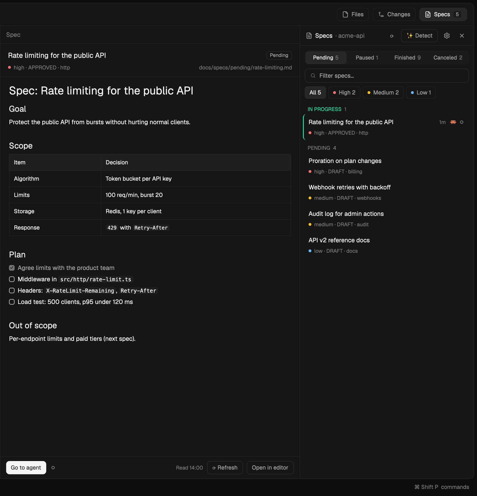

# SDD-Focused

A Specs panel for spec-driven development in Herdr. It follows the active space's project and lists its spec files (Markdown) by status: Pending, Paused, Finished and Canceled. Filter by text or priority, pin the critical ones, mark the ones in progress, open any spec rendered in a pane beside the terminal, and start a coding agent on it with one click. Specs that have an agent on them show that agent's live state (working, needs you, done) and how long it has been in it.

## What you see

The panel docks on the right (380px, `mod.json` `place: "right"`), on the theme's `background`. Top to bottom:

- **Header, 42px**, bottom hairline (`border`): a document icon, "Specs" in medium weight, "· <project>" in `dim`, then a ⟳ refresh button, an outlined "✨ Detect" button, a ⚙ button (agents & models) and ✕ (close). All buttons have tooltips.
- **Status tabs**: a segmented pill (`popover`, 8px radius, 2px padding) with Pending · Paused · Finished · Canceled and each count; the active one is `selected` with an `input` outline.
- **Filter field**, 30px, 8px radius, `input` outline, search icon, placeholder "Filter specs…".
- **Priority chips** when the shown specs have two or more priorities: "All N", then one per priority with a dot (critical/high `blocked`, medium `working`, low `ansi4`, none `dim`).
- **The list**, scrolling on its own. Pending is grouped: "📌 PINNED" (title in `working`), "IN PROGRESS" (`done`), then "PENDING" (`dim`), or "PENDING · <label>" per source when a project has several spec folders. Each spec is two lines: its title (13px) and a meta line (11px, `dim`): a priority dot, then `⏸ postponed · priority · status · module` from its frontmatter (Finished adds `closed <date>`). A pinned spec has a 2px `working` left border; one in progress a `done` border.

A spec opens in a **viewer pane**: title (15px semibold) with a status badge (Pending, Paused, Finished, Canceled), the meta line and the file's path, the Markdown rendered (headings, tables, code, checklists) in a scrolling body, and a footer with "▶ Work on it" (solid) or "Go to agent", the time it was read, "⟳ Refresh" and "Open in editor".

⚙ opens the **Spec agents** dialog (460×560): two cards, "▶ Work on a spec" and "✨ Detect folders", each with the installed agents as chips (with their icons), model chips ("Default", and opus/sonnet/haiku/fable for Claude Code) plus a free-text model field, an "Autonomous mode" checkbox showing the exact flag, and a monospace preview of the command it will run.

## How it behaves

- **Which project:** the active space's repo (its first terminal's folder, `git rev-parse --show-toplevel`); a worktree uses its main checkout's entry. Switching spaces switches the list.
- **Where specs are:** `~/.config/herdr-app/sdd-focused.json` maps a repo to its spec folders: `{ "projects": { "/abs/repo": { "sources": [{ "dir": "docs/specs", "label": "API", "folders": { "pending": "pending", "finished": "done" } }] } } }`. Without an entry, `<repo>/docs/specs` is tried. Status subfolders are recognised by name in English or Spanish (`pending`/`pendientes`, `paused`/`pausados`/`on-hold`, `finished`/`done`/`finalizados`, `canceled`/`cancelled`/`cancelados`). Files starting with `_` (templates) are skipped.
- **A spec:** title from `# Spec: X`, else the first `# ` heading, else the file name. Frontmatter keys `priority`/`prioridad`, `status`/`estado`, `module`/`modulo`, `created`/`fechaCreacion`, `closed`/`fechaCierre`. A pending spec whose first heading says it is postponed or paused counts as Paused.
- **Sorting:** pending and paused by priority, then newest; finished and canceled by closing date, newest first.
- **Hover a pending spec:** pin, mark in progress (◻/◼) and ▶ appear. Pins and marks are kept per project.
- **▶ Work on it:** checks with `knownAgents()` that the chosen agent is installed (else a warning notice, no tab), then `tab.new` named after the spec runs it with the prompt "Work on the spec <path>…" (as an argument for Claude Code and Codex, as Herdr's task for others). The new terminal is labelled `spec=<abs path>` with `hc label`, which is how the list knows which agent works on which spec.
- **An agent on a spec:** working shows a spinning ring, blocked a red "Needs you", done a green dot, idle a ring, with the time since its last change. Clicking the agent's icon focuses its pane.
- **✨ Detect:** starts the "detect" agent (Claude Code with Haiku by default) in a new tab, asking it to find the project's spec folders and write its entry in `sdd-focused.json`, touching nothing in the repo.
- **Refresh:** everything (spec files, the config, an open spec) is read again every 5 minutes and on ⟳. No folder watchers.
- **Close (✕):** hides the layout node with id `panel` that holds the mod, else the mod's own block.
- **Tab bar badge (optional):** the panel publishes shared state `sdd.badge` = `{ space, n, pending: [paths] }`; a tab bar can show the count and a red dot when an agent on one of those specs is blocked. The minimalistic layout's tab bar does.

## Built from

- One mod, `sdd-focused`, three views chosen by props: no props → the panel (`panel.js`); `{ file, root, on, space }` → the viewer (`viewer.js`, opened with `pane.split {direction: "right", mod: "sdd-focused", props}`, one per tab, replacing the previous one); `{ agentSettings: true }` → the dialog (`settings.js`, `openOverlay({ mod, kind: "dialog" })`).
- `lib/specs.js`: finding folders and reading specs (no UI); `lib/agents.js`: agent profiles, preferences, launching and labelling (no UI); `lib/ui.js`: buttons, chips, field, status marks; `lib/util.js`: helpers and bounded concurrency (16 files read at once).
- Herdr functions: `spaces`, `panes`, `agents`, `terminals`, `layout`, `window`, `theme`, `props`, `shared`/`setShared`, `run`, `exec`, `hc`, `readTextFile`, `appHome`, `knownAgents`, `notify`, `openOverlay`/`closeOverlay`; `TextView.markdown` and `InputState`/`Input` from gpui-base. Commands: `tab.new`, `pane.split`, `pane.close`, `pane.focus`, `layout.hide`.
- Programs run: `git rev-parse` (in the space's folder), `find` (in the spec folders), `hc label`, and `open`/`xdg-open`/`start` for "Open in editor". No network requests.
- Shared state: `sdd.agents` (the dialog's choices), `sdd.badge` (for tab bars). Per-copy `localStorage`: pins, marks, the shown status, agent state times.
- Art: the shipped `mods/workspace-chrome/*.svg` icons (file-text, x, settings, search, pin, pin-off, spinner).

## Watch out

- One mod can't import another mod's files in Herdr: keep everything inside `mods/sdd-focused/`.
- Side effects stay out of `render()`: the badge is published after each load, not while drawing.
- `knownAgents()` lists only agents with a `run` entry; an agent missing there falls back to running its name.
- Autonomous-mode flags are known for Claude Code, Codex, Gemini and Cursor only; other agents get the model as `--model`, untested.
- Remote spaces work (commands run `on` the space's machine), but there is no "Open in editor" for them.
- Herdr writes `jsconfig.json` and `*.d.ts` beside a mod on load; they're not part of it.

## Done when

- `herdr-app check mods/sdd-focused` passes.
- In a repo with `docs/specs/pending/*.md`, the panel lists them with the right counts in the status tabs, and Paused includes a pending spec whose first heading says "postponed".
- Clicking a spec opens one viewer pane to the right with the Markdown rendered; clicking another replaces it.
- With no spec folders, the panel offers "✨ Detect with an agent".
- ▶ on a pending spec opens a tab named after it running the chosen agent; within a few seconds the spec moves to IN PROGRESS and shows that agent's state.
- With the chosen agent uninstalled, ▶ shows a warning notice and opens nothing.
